<picture><source media="(prefers-color-scheme: dark)" srcset="assets/hero-dark.svg"></picture>

<picture><source media="(prefers-color-scheme: dark)" srcset="assets/about-dark.svg"></picture>

<picture><source media="(prefers-color-scheme: dark)" srcset="assets/stack-dark.svg"></picture>

<a href="https://github.com/niksdot/filecopier"><picture><source media="(prefers-color-scheme: dark)" srcset="assets/project-filecopier-dark.svg"></picture></a>&nbsp;<a href="https://github.com/niksdot/sfetch"><picture><source media="(prefers-color-scheme: dark)" srcset="assets/project-sfetch-dark.svg"></picture></a>

<a href="https://github.com/niksdot/thefear"><picture><source media="(prefers-color-scheme: dark)" srcset="assets/project-thefear-dark.svg"></picture></a>&nbsp;<a href="https://github.com/niksdot/win-monitor"><picture><source media="(prefers-color-scheme: dark)" srcset="assets/project-win-monitor-dark.svg"></picture></a>

<picture><source media="(prefers-color-scheme: dark)" srcset="assets/stats-dark.svg"></picture>

<picture><source media="(prefers-color-scheme: dark)" srcset="assets/streak-dark.svg"></picture>

<picture><source media="(prefers-color-scheme: dark)" srcset="assets/wave-dark.svg"></picture>

<a href="https://example.com"><picture><source media="(prefers-color-scheme: dark)" srcset="assets/button-1-dark.svg"></picture></a>&nbsp;&nbsp;<a href="https://github.com/niksdot?tab=repositories"><picture><source media="(prefers-color-scheme: dark)" srcset="assets/button-2-dark.svg"></picture></a>

<a href="https://metawka.github.io/expressive-profile/?from=niksdot"><picture><source media="(prefers-color-scheme: dark)" srcset="assets/credit-dark.svg"></picture></a>

